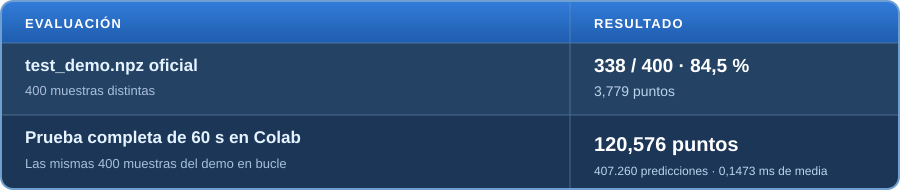

<div align="center">


<br>
  
  
  
  
  
  <a href="https://colab.research.google.com/github/DavidTorro/gdg-uam-ml-contest-2026/blob/main/colab.es.ipynb"></a>
  <a href="https://github.com/DavidTorro">
    
  </a>
  <p>
    <a href="README.md"></a>
  </p>
</div>

# GDG UAM ML Contest 2026

Mi participación individual en el [GDG UAM ML Contest 2026](https://gdguam.es/blog/guia-concurso-de-ml). El objetivo es clasificar una serie temporal de cuatro canales y 256 valores en una de ocho clases. El evaluador oficial llama a `predict` para cada muestra por separado y puntúa tanto la calidad como la velocidad.

## Modelo

`model.py` carga por defecto `models/exp033.sesgo.onnx`. Es una CNN 1D exportada a ONNX, con el ajuste de la salida de la clase 6 incorporado en el propio peso. La inferencia usa ONNX Runtime en un hilo de CPU. Numba compila la preparación durante la inicialización; los buffers reutilizables y el I/O Binding de ONNX Runtime reducen el coste por muestra. La ruta de inferencia predeterminada no necesita PyTorch ni los datos de entrenamiento.

## Resultados en el demo



Una medición corta en Colab de 0,1064 ms por predicción sugería unos 142 puntos si ese ritmo se mantenía. La ejecución completa del harness sumó 60 s de `predict`, promedió 0,1473 ms en 407.260 predicciones y dio 120,576 puntos con el demo repetido. Con la misma mezcla de muestras, la puntuación crece aproximadamente con la raíz cuadrada del número de respuestas; la menor velocidad sostenida explica la diferencia. Ambas pruebas reutilizan las mismas 400 muestras públicas.

## Archivos de entrega

```text
.
├── model.py                    # Punto de entrada Model
├── models/
│   └── exp033.sesgo.onnx       # CNN y ajuste de la clase 6
├── src/
│   ├── __init__.py             # Marca el paquete Python
│   ├── caracteristicas.py      # Rasgos importados por model.py
│   ├── preparacion_numba.py    # Preparación JIT en buffers
│   ├── red_numpy.py            # Preparación NumPy auxiliar
│   └── red_onnx.py             # ONNX Runtime e I/O Binding
└── requirements.txt            # Dependencias de inferencia fijadas
```

El harness oficial aporta `competition_api.py`; este repositorio no lo incluye.

## Prueba desde un clon limpio

Elige un entorno. Los comandos locales requieren Git, Python 3.10 o posterior y `curl`. Ejecuta los bloques en orden desde un directorio nuevo.

### macOS · Terminal

**1. Clona la entrega y el material oficial**

```bash
mkdir gdg-uam-submission-check
cd gdg-uam-submission-check
git clone https://github.com/DavidTorro/gdg-uam-ml-contest-2026.git submission-check
git clone https://github.com/GDG-UAM/ml-contest-materials.git
```

**2. Crea el entorno Python e instala las dependencias de inferencia**

```bash
python3 -m venv .venv
.venv/bin/python -m pip install -r submission-check/requirements.txt
```

**3. Descarga el demo público y ejecuta el harness oficial**

```bash
curl -fL --create-dirs -o ml-contest-materials/data/test_demo.npz \
  https://github.com/GDG-UAM/ml-contest-materials/releases/latest/download/test_demo.npz
cd ml-contest-materials
../.venv/bin/python harness.py evaluate --model ../submission-check/model.py \
  --source file:data/test_demo.npz --runs 1
```

### Linux · Terminal

**1. Clona la entrega y el material oficial**

```bash
mkdir gdg-uam-submission-check
cd gdg-uam-submission-check
git clone https://github.com/DavidTorro/gdg-uam-ml-contest-2026.git submission-check
git clone https://github.com/GDG-UAM/ml-contest-materials.git
```

**2. Crea el entorno Python e instala las dependencias de inferencia**

```bash
python3 -m venv .venv
.venv/bin/python -m pip install -r submission-check/requirements.txt
```

**3. Descarga el demo público y ejecuta el harness oficial**

```bash
curl -fL --create-dirs -o ml-contest-materials/data/test_demo.npz \
  https://github.com/GDG-UAM/ml-contest-materials/releases/latest/download/test_demo.npz
cd ml-contest-materials
../.venv/bin/python harness.py evaluate --model ../submission-check/model.py \
  --source file:data/test_demo.npz --runs 1
```

### Windows · PowerShell

**1. Clona la entrega y el material oficial**

```powershell
New-Item -ItemType Directory gdg-uam-submission-check
Set-Location gdg-uam-submission-check
git clone https://github.com/DavidTorro/gdg-uam-ml-contest-2026.git submission-check
git clone https://github.com/GDG-UAM/ml-contest-materials.git
```

**2. Crea el entorno Python e instala las dependencias de inferencia**

```powershell
py -3 -m venv .venv
& .\.venv\Scripts\python.exe -m pip install -r .\submission-check\requirements.txt
```

**3. Descarga el demo público y ejecuta el harness oficial**

```powershell
curl.exe -fL --create-dirs -o ml-contest-materials\data\test_demo.npz `
  https://github.com/GDG-UAM/ml-contest-materials/releases/latest/download/test_demo.npz
Set-Location ml-contest-materials
& ..\.venv\Scripts\python.exe harness.py evaluate --model ..\submission-check\model.py `
  --source file:data/test_demo.npz --runs 1
```

El demo público debe dar **338 aciertos de 400** (84,5 %). El tiempo de ejecución y la latencia dependen del equipo.

### Google Colab · sin instalación local

El [cuaderno de comprobación en español](https://colab.research.google.com/github/DavidTorro/gdg-uam-ml-contest-2026/blob/main/colab.es.ipynb) hace la misma prueba en un entorno CPU de Colab. Clona ambos repositorios públicos, instala las dependencias fijadas, comprueba el SHA-256 del demo descargado y ejecuta el harness oficial.

1. Abre el cuaderno y conéctate a un **entorno de ejecución CPU nuevo**. Si ya contiene un clon anterior, elige **Entorno de ejecución → Desconectar y eliminar entorno de ejecución** y vuelve a conectar.
2. Elige **Entorno de ejecución → Ejecutar todas**. Colab ejecuta las celdas en orden; la instalación de dependencias y la inicialización del modelo pueden tardar unos minutos.
3. Comprueba la tabla final **✅ CORRECTO · demo público**: 400 muestras, 338 aciertos y una puntuación aproximada de 3,778906. El commit mostrado es la revisión clonada en esa ejecución; la latencia puede variar.

El cuaderno solo descarga el demo público y no entrena el modelo.
