<div align="center">


<br>
  
  
  
  
  
  
  <br>
  <a href="https://github.com/DavidTorro">
    
  </a>
</div>

# GDG UAM ML Contest 2026

[Leer en español](README.es.md)

My individual entry for the [GDG UAM ML Contest 2026](https://github.com/GDG-UAM/ml-contest-materials). The task is to classify a four-channel, 256-step time series into one of eight classes. The official harness calls `predict` on one sample at a time and scores both accuracy and throughput.

## Model

`model.py` loads `models/exp033.sesgo.onnx` by default. It is a 1D CNN exported to ONNX, including the class-6 logit adjustment in the weight file. Inference uses ONNX Runtime on one CPU thread. Numba compiles preprocessing during setup; reusable buffers and ONNX Runtime I/O Binding reduce per-sample overhead. The default inference path does not require PyTorch or training data.

## Demo results

| Evaluation | Result |
| --- | ---: |
| Official `test_demo.npz` (400 distinct samples) | 338/400 correct · 84.5% accuracy · 3.779 score |
| Colab throughput check (the same 400 demo samples repeated until 60 s of `predict`) | 120.576 score |

These are checks on the public demo, **not a hidden-test score or an estimate of it**. The repeated-demo run measures the inference path under a longer time budget; it does not add independent test examples.

## Submission files

| Path | Purpose |
| --- | --- |
| `model.py` | Official `Model` entry point |
| `models/exp033.sesgo.onnx` | Trained CNN and embedded logit adjustment |
| `src/red_onnx.py` | ONNX Runtime inference and I/O Binding |
| `src/preparacion_numba.py` | JIT preprocessing into reusable buffers |
| `src/red_numpy.py` | NumPy preprocessing fallback used by the ONNX module |
| `src/caracteristicas.py`, `src/__init__.py` | Imports required by the entry point |
| `requirements.txt` | Pinned inference dependencies |

The official harness provides `competition_api.py`; it is not part of this repository.

## Test from a fresh clone

Run these commands in a clean Python 3.10+ environment:

```bash
git clone https://github.com/DavidTorro/gdg-uam-ml-contest-2026.git submission-check
git clone https://github.com/GDG-UAM/ml-contest-materials.git
python -m pip install -r submission-check/requirements.txt
curl -L --create-dirs -o ml-contest-materials/data/test_demo.npz \
  https://github.com/GDG-UAM/ml-contest-materials/releases/latest/download/test_demo.npz
cd ml-contest-materials
python harness.py evaluate --model ../submission-check/model.py \
  --source file:data/test_demo.npz --runs 1
```

The complete development snapshot, including training scripts and experiments, remains available in [commit `ffb3255`](https://github.com/DavidTorro/gdg-uam-ml-contest-2026/tree/ffb3255).
